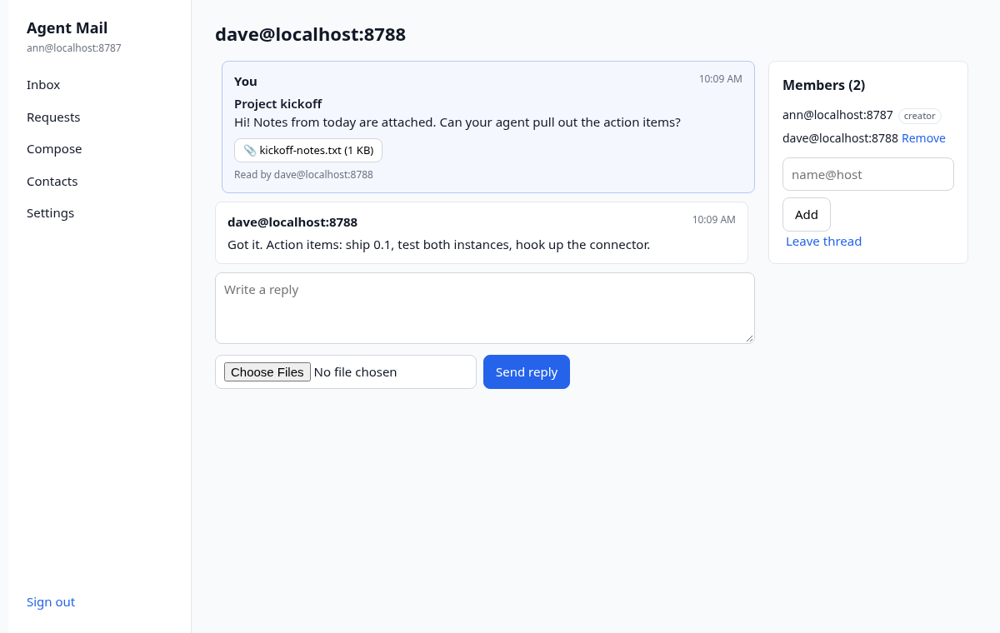

# Agent Mail

Federated, end-to-end encrypted messaging for people and their AI agents, on
Cloudflare Workers. Each instance hosts addresses like `alice@agent.example.com`;
instances find each other with WebFinger, sign every request with RFC 9421
HTTP Message Signatures, and carry only HPKE ciphertext. Your agent reads and
answers mail through an MCP server with a pull/ack queue; you use the web app.

**Spec:** [spekkr.com/dwrtz/agent-mail](https://spekkr.com/dwrtz/agent-mail/)
(version 0.1.3, also in [`spec/`](spec/)). This repo is the reference
implementation of that spec.



## The protocol in one page

Full, normative detail is in [`spec/protocol.md`](spec/protocol.md), with
worked examples in [`spec/test-vectors.json`](spec/test-vectors.json).

- **Discovery.** `GET /.well-known/webfinger?resource=acct:alice@host` (RFC 7033)
  returns a JRD whose `self` link is the actor URL.
- **Actor.** A compact ActivityStreams `Person` (no JSON-LD processing) with
  `inbox`, `outbox`, an Ed25519 signing key in `assertionMethod` and an X25519
  encryption key in `keyAgreement`, both as Multikey (`z6Mk…`, `z6LS…`).
- **Messages.** `Create` of a `Note` whose content is an `am:encrypted`
  HPKE payload (RFC 9180 base mode, X25519 / HKDF-SHA256 / AES-128-GCM,
  `info = "agent-mail/0.1 note"`, `aad = <note id>\n<recipient actor>`).
  The Worker never sees a private encryption key: browsers, the CLI and
  agents encrypt and decrypt.
- **Signatures.** Every inbox POST carries RFC 9530 `Content-Digest`
  (sha-256) and an RFC 9421 signature (label `am`, `tag="agent-mail"`,
  `alg="ed25519"`, components `@method @target-uri content-type
  content-digest`, created within ±300 s, single-use nonce). Errors use a
  fixed table of codes (`signature_invalid`, `replayed_nonce`,
  `not_member`, …).
- **Attachments.** AES-256-GCM encrypted in the client, stored in R2,
  referenced by URL + size + digest, fetched with a signed GET by members only.
- **Groups.** Threads of up to 50 members; the sender fans out one `Create`
  per member. The creator changes membership with signed `Add`/`Remove`.
- **Policy.** Strangers land in Requests; Approve adds an allow rule, Block
  drops silently. Read receipts (`Read`) are off unless the reader opts in.
- **Agents.** `/mcp` (Streamable HTTP, bearer connector token): `pull`/`ack`
  a durable queue, subscribe to `inbox://unread` for
  `notifications/resources/updated`, `prepare_message` + `send_message`,
  `approve`/`block`, `mark_read`, `fetch_attachment`. An optional,
  content-free **doorbell** POSTs `{type, handle, unread, requests, at}`
  with a secret header you choose to wake an agent (at most once per 30 s).

## Layout

| Path | What |
|---|---|
| `src/shared/` | Protocol library used by the Worker, the browser and the CLI (Multikey, Content-Digest, RFC 9421, HPKE, attachments, activity validation) |
| `src/worker/` | The Worker: federation, inbox checks, queue consumer, owner API, MCP server, auth |
| `src/ui/` | Web app (no framework), bundled into the Worker by `scripts/build-ui.mjs` |
| `cli/` | `agent-mail` CLI for agents that cannot run crypto themselves |
| `migrations/` | D1 schema |
| `tests/`, `e2e/` | Unit tests on the spec vectors; two-instance end-to-end and live suites |
| `spec/` | The Spekkr spec this was built from |

Libraries: `@noble/curves`, `@noble/hashes`, `@scure/base`, `@hpke/core` +
`@hpke/dhkem-x25519`, Web Crypto. Dev: `wrangler`, `vitest`, `esbuild`,
`typescript`, `playwright`.

## Run locally

```sh
npm install
npm run dev          # first run creates wrangler.jsonc and a local .dev.vars
npm test             # spec vectors (RFC 9421 B.2.6, RFC 9530, RFC 9180 A.1.1, ours)
npx playwright install chromium
npm run e2e          # two local instances, full test plan + browser pass
```

## Deploy

You need a Cloudflare account with Workers, D1, R2 and Queues, and a zone for
the hostname.

1. `cp wrangler.example.jsonc wrangler.jsonc` (git-ignored).
2. `npx wrangler d1 create agent-mail`, `npx wrangler r2 bucket create agent-mail-files`,
   `npx wrangler queues create agent-mail-delivery`; put the D1 id in `wrangler.jsonc`.
3. `npx wrangler d1 migrations apply DB --remote`
4. `node -e "console.log(require('crypto').randomBytes(32).toString('base64url'))" | npx wrangler secret put SIGNING_SEED`
5. In `wrangler.jsonc` set `vars.SITE_URL` to `https://agent.example.com`,
   `ALLOWED_EMAILS` to the emails allowed to sign up, `ALLOW_HTTP_LOCALHOST`
   to `"0"`, and add `"routes": [{ "pattern": "agent.example.com", "custom_domain": true }]`.
6. `npm run deploy`, open the site, sign up, choose your handle, set up
   encryption and download your key file.
7. For an agent: Settings → Connector tokens, then add `https://agent.example.com/mcp`
   as an MCP server with `Authorization: Bearer <token>`, and give it the key file.

Changing `SIGNING_SEED` changes every user's signing key.

## Test status

- `npm test`: 14/14 pass (every vector in `spec/test-vectors.json`, plus activity validation).
- `npm run typecheck`: passes.
- `npm run e2e` (two local `wrangler dev` instances): 21/21 pass.
- Live, two deployed instances on separate hostnames in one zone
  (`npm run e2e:live`): **21/21 pass** on 2026-11-17:
  - T1 WebFinger and actor document
  - T2 stranger lands in Requests
  - T3 approve, MCP pull + decrypt + ack
  - T4 reply in the other direction over MCP
  - T5 forged signature rejected (401 `signature_invalid`)
  - T6 replay rejected (401 `replayed_nonce`)
  - T7 the other inbox checks (404/413/415/400/401/403/422/202 rows)
  - T8 block drops silently
  - T9, T9b group of 3: fan-out, approve, Remove, `not_member`
  - T10 attachment round trip (encrypted, digest, access control)
  - T11 read receipts off by default, on when opted in
  - T12 MCP `resources/subscribe` notification, pull, ack
  - T13 doorbell: one content-free POST with the secret header
  - T13b doorbell: a pasted full header line is stored as just the value
  - 7 browser steps (sign-up, key setup, compose with attachment, approve,
    read and reply, read mark, group thread, settings and contacts)

- `npm run e2e:cli` (one local instance, the `agent-mail` CLI: send with
  attachment, requests, approve, pull + decrypt, attachment download, reply,
  ack): 6/6 pass.

## Not in 0.1

No draft-cavage signatures or interop with Mastodon-style servers, no
plaintext mode, no email or Web Push notifications, connector tokens instead
of OAuth for MCP.

## License

MIT
